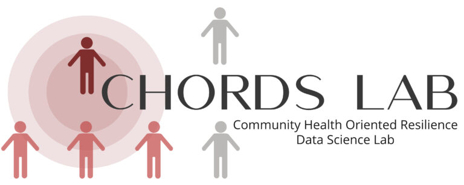
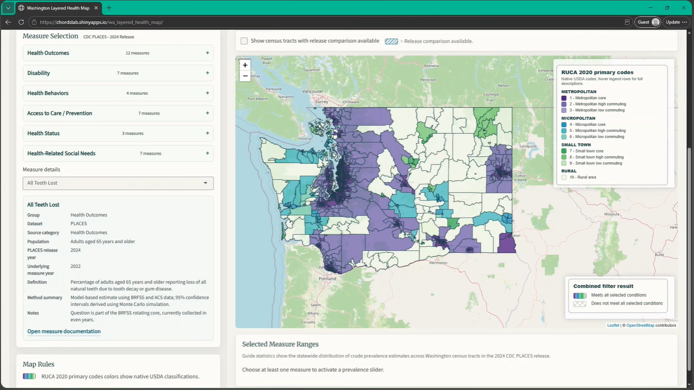

  

# CHORDS Lab

The Community Health Oriented Resilience Data Science (CHORDS) Lab at Washington State University focuses on creating resources for clinical data scientists, community researchers, and citizen scientists interested in understanding the socio-environmental factors influencing individual stress levels and biological stress responses.

[Learn more about CHORDS Lab](https://labs.wsu.edu/chords/)

## Research Projects & Resources

### Allostatic (over)Load Repository

Guides and R scripts for preparing datasets to study allostatic (over)load using the Health and Retirement Study (HRS), National Health and Nutrition Examination Survey (NHANES), and NIH *All of Us* Research Program. The *All of Us* section is under development.

[View the repository](https://github.com/CHORDSLab/Allostatic-over-Load-Repository)

### HRS Stress Measures and Supplementary Datasets

Guides and R scripts for preparing longitudinal stress measures and supplementary geographic data from HRS. Outputs are standardized to person-year for integration with the lab's HRS allostatic (over)load data.

[View the repository](https://github.com/CHORDSLab/HRS-Stress-Measures-and-Supplementary-Datasets)

### Washington Layered Health Map

The Washington Layered Health Map is an interactive [CHORDS Lab](https://labs.wsu.edu/chords/) project designed to support exploration of geographic patterns in health outcomes, health behaviors, and access to care across Washington State.

The current application primarily uses [CDC PLACES](https://www.cdc.gov/places/index.html) modeled estimates and supports exploration at both census tract and county geographies

**[Explore the interactive map](https://chordslab.shinyapps.io/wa_layered_health_map/)** · [About the project](https://labs.wsu.edu/chords/wa-layered-health-map/)

#### Watch the Map Demo

[Watch the demonstration on YouTube](https://www.youtube.com/watch?v=VfFl5SrZk2Y)
